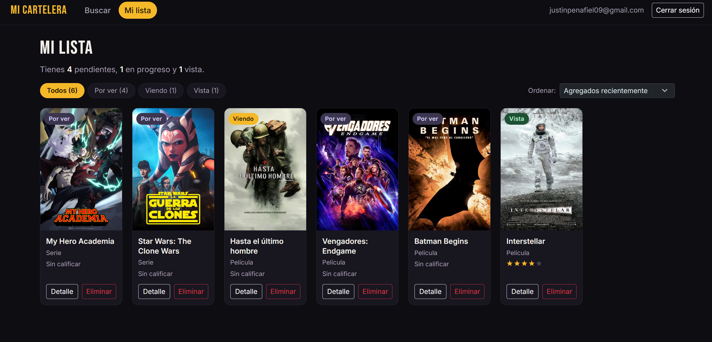
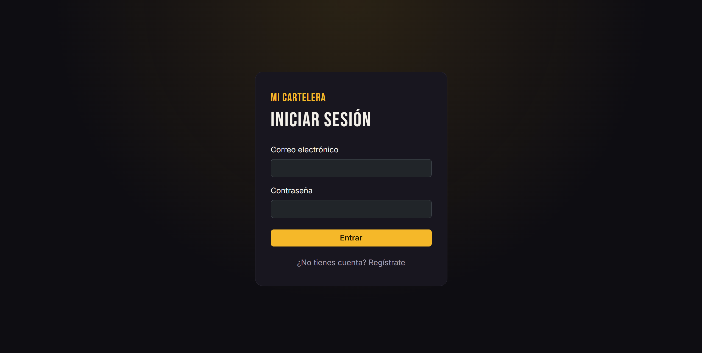
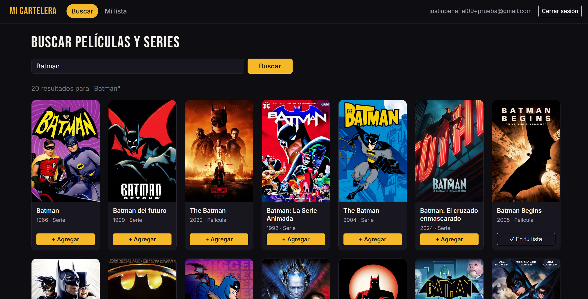
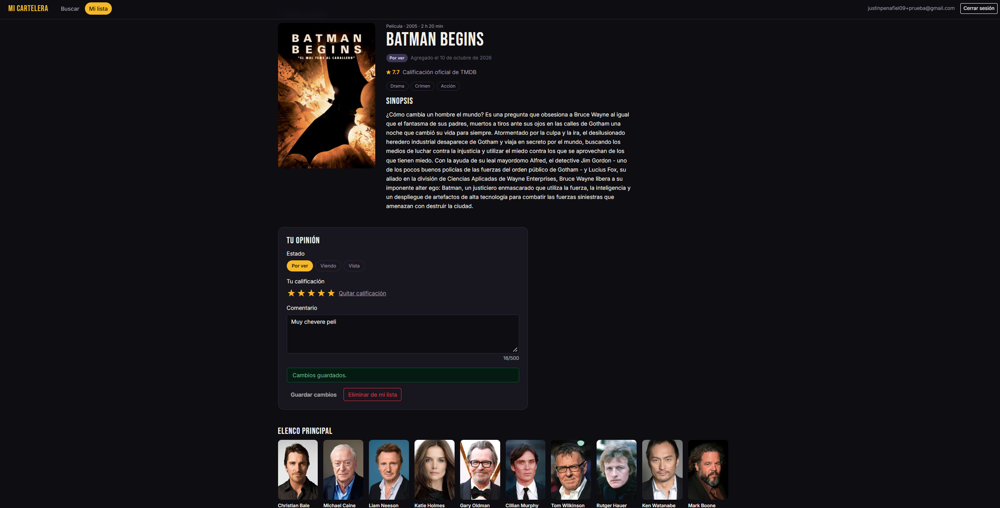
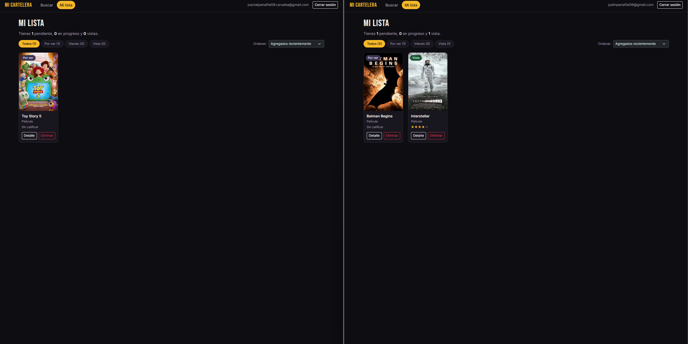
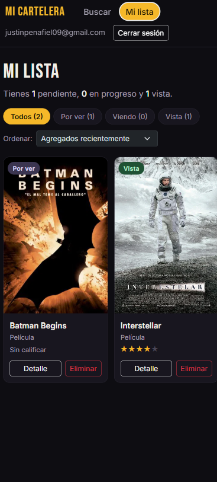

# 🎬 Mi Cartelera Personal

Aplicación web para guardar las películas y series que quieres ver, las que estás viendo y las que ya viste, con tu calificación y comentario personal. Busca en el catálogo de **TMDB**, guarda en tu lista privada en **Supabase** y lleva el control de todo lo que miras.

**🔗 Demo en vivo:** https://mi-cartelera-kappa.vercel.app
**📦 Repositorio:** https://github.com/Justinmate0/mi-cartelera

> Entregable 3 — Desarrollo Web 2, USFQ · Justin Peñafiel



---

## Funcionalidades

### Requisitos
- **Autenticación con Supabase Auth:** registro, inicio de sesión y botón de **Cerrar sesión** siempre visible. Sin sesión no se ve ninguna pantalla de la app; la sesión se mantiene al recargar.
- **Búsqueda en TMDB** de películas y series, con póster, título y año. Incluye estado de **carga** (spinner), **error** (con botón *Reintentar*) y **sin resultados**, además de validación del texto buscado.
- **Agregar a mi lista** desde los resultados. El botón cambia a **"✓ En tu lista"** si el título ya está guardado.
- **CRUD completo** sobre la tabla `mi_lista`:
  - **Crear:** agregar desde la búsqueda.
  - **Leer:** vista *Mi lista*.
  - **Actualizar:** estado, calificación y comentario.
  - **Eliminar:** con confirmación previa.
- **Estado de visualización** tipado como unión de TypeScript: `"por_ver" | "viendo" | "vista"`.
- **Calificación personal de 1 a 5 estrellas** y **comentario** (máx. 500 caracteres).
- **Página de detalle** con póster grande, sinopsis completa, **elenco con fotos**, géneros, duración, nota oficial de TMDB, y tu calificación y comentario editables.
- **Seguridad con RLS:** cada usuario solo puede ver, crear, editar y eliminar **sus propias** filas (verificado con dos cuentas, ver abajo).

### Extras
- **Filtro por estado:** Todos / Por ver / Viendo / Vista, con la cantidad de cada uno.
- **Ordenar** por agregados recientemente, agregados hace más tiempo o mejor calificados.
- **Contador:** *"Tienes 4 pendientes, 1 en progreso y 1 vista."*
- **Publicada en Vercel**, con despliegue automático en cada push a `main`.
- **Diseño responsive:** se adapta a celular sin desbordes horizontales.
- **Mensajes de error en español**, traducidos desde Supabase y TMDB.

---

## Capturas

| Inicio de sesión | Búsqueda |
|---|---|
|  |  |

| Mi lista (contador, filtros y orden) | Detalle con elenco y "Tu opinión" |
|---|---|
|  |  |

**Prueba de RLS con dos cuentas distintas:** cada usuario ve solo su propia lista.



**Vista en celular:**



---

## Tecnologías

| Herramienta | Uso |
|---|---|
| **React 19 + TypeScript** | Interfaz y tipado estricto (sin `any`). |
| **Vite** | Entorno de desarrollo y build. |
| **Supabase** (`@supabase/supabase-js`) | Autenticación y base de datos PostgreSQL con Row Level Security. |
| **TMDB API v3** | Catálogo de películas y series: búsqueda, detalle y elenco. |
| **Bootstrap 5** + CSS propio | Estilos, con tema oscuro. |
| **Vercel** | Publicación. |

---

## Instalación y uso local

### Requisitos previos
- **Node.js 20.19 o superior** (recomendado 22 LTS) y npm.
- Una cuenta gratuita en [Supabase](https://supabase.com).
- Una cuenta gratuita en [TMDB](https://www.themoviedb.org) con acceso a la API.

### 1. Clonar e instalar dependencias
```bash
git clone https://github.com/Justinmate0/mi-cartelera.git
cd mi-cartelera
npm install
```

### 2. Crear la base de datos en Supabase
1. Crea un proyecto nuevo en Supabase.
2. Abre **SQL Editor → New query**, pega todo el contenido de [`supabase/schema.sql`](supabase/schema.sql) y presiona **Run**. Esto crea la tabla `mi_lista`, activa RLS y crea sus 4 políticas.
3. *(Opcional, para probar más rápido)* En **Authentication → Sign In / Providers → Email** puedes desactivar **Confirm email**. Si lo dejas activo, cada cuenta nueva debe confirmar su correo antes de iniciar sesión.

### 3. Configurar variables de entorno
Copia el archivo de ejemplo y completa los valores reales:
```bash
cp .env.example .env
```

| Variable | Dónde se obtiene |
|---|---|
| `VITE_SUPABASE_URL` | Supabase → **Connect** (o Project Settings → Data API) → *Project URL* |
| `VITE_SUPABASE_ANON_KEY` | Supabase → Project Settings → **API Keys** → clave *publishable* (`sb_publishable_…`) o *anon*. **Nunca** la `secret` / `service_role`. |
| `VITE_TMDB_TOKEN` | TMDB → Settings → **API** → *API Read Access Token* (el token largo) |

> El archivo `.env` está en `.gitignore` y **no se sube al repositorio**.

### 4. Ejecutar
```bash
npm run dev
```
Abre http://localhost:5173, crea una cuenta y empieza a buscar.

### Scripts disponibles
| Comando | Qué hace |
|---|---|
| `npm run dev` | Servidor de desarrollo con recarga en caliente. |
| `npm run build` | Revisa los tipos con TypeScript y genera la versión de producción en `dist/`. |
| `npm run preview` | Sirve localmente la versión de producción. |
| `npm run lint` | Revisa el código con oxlint. |

---

## Base de datos y seguridad (RLS)

Tabla `public.mi_lista` (definida en [`supabase/schema.sql`](supabase/schema.sql)):

| Columna | Tipo | Notas |
|---|---|---|
| `id` | `bigint` | Clave primaria autoincremental. |
| `user_id` | `uuid` | Dueño de la fila. Por defecto `auth.uid()`; referencia a `auth.users` (se borra en cascada). |
| `tmdb_id` | `int` | ID del título en TMDB. |
| `titulo` | `text` | |
| `poster_url` | `text` | Puede ser `null`. |
| `tipo_contenido` | `text` | `'pelicula'` o `'serie'` (check). |
| `estado` | `text` | `'por_ver'`, `'viendo'` o `'vista'` (check). Por defecto `'por_ver'`. |
| `calificacion_personal` | `int` | Entre 1 y 5 (check), o `null`. |
| `comentario` | `text` | Puede ser `null`. |
| `fecha_agregado` | `timestamptz` | Por defecto `now()`. |

Además, `unique (user_id, tmdb_id, tipo_contenido)` evita que un usuario guarde dos veces el mismo título.

**Row Level Security** está activado, con 4 políticas (`select`, `insert`, `update` y `delete`). Todas comparan `auth.uid() = user_id`, así que la base de datos misma rechaza cualquier intento de leer o modificar filas de otro usuario, aunque alguien manipule las peticiones desde el navegador.

### Cómo se verificó
1. Se crearon **dos cuentas** y cada una inició sesión en una ventana distinta (normal e incógnito).
2. Cada cuenta agregó títulos diferentes. Al recargar, **cada una vio solo su propia lista**. En la búsqueda, un título guardado por la otra cuenta aparecía como *"+ Agregar"* y no como *"✓ En tu lista"*.
3. En el **SQL Editor** de Supabase (que funciona como administrador y no aplica RLS) se confirmó que las filas de ambas cuentas existen en la misma tabla, cada una con su `user_id`.

Ver la captura [`05-rls-dos-cuentas.png`](docs/capturas/05-rls-dos-cuentas.png).

### Sobre las variables `VITE_`
Vite incluye en el código del navegador las variables que empiezan con `VITE_`, así que **son visibles para cualquiera que inspeccione la página**. Por eso solo se usan claves pensadas para ser públicas:
- La **URL** y la clave **publishable/anon** de Supabase: su seguridad depende de RLS, no de mantenerlas en secreto.
- El **token de lectura de TMDB**: solo permite consultar información pública del catálogo.

La clave `secret` / `service_role` de Supabase **nunca** se usa en el frontend.

---

## Estructura del proyecto

```
mi-cartelera/
├── supabase/
│   └── schema.sql             # Tabla mi_lista, RLS y políticas
├── docs/capturas/             # Capturas usadas en este README
├── src/
│   ├── lib/
│   │   └── supabaseClient.ts  # Cliente único de Supabase
│   ├── services/              # Toda la comunicación con APIs
│   │   ├── authService.ts     # Registro, login, logout, sesión
│   │   ├── tmdbService.ts     # Búsqueda y detalle en TMDB
│   │   └── miListaService.ts  # CRUD de mi_lista
│   ├── types/
│   │   ├── catalogo.ts        # Tipos de resultados de TMDB
│   │   └── miLista.ts         # EstadoVisualizacion, ItemLista...
│   ├── components/
│   │   ├── PantallaAuth.tsx       # Login / registro
│   │   ├── BarraUsuario.tsx       # Navegación + cerrar sesión
│   │   ├── Buscador.tsx           # Búsqueda con carga / error / vacío
│   │   ├── TarjetaResultado.tsx
│   │   ├── MiLista.tsx            # Contador, filtro y orden
│   │   ├── TarjetaItemLista.tsx
│   │   ├── DetalleTitulo.tsx      # Detalle + edición
│   │   ├── Estrellas.tsx          # Calificación 1–5
│   │   ├── EstadoBadge.tsx
│   │   ├── Poster.tsx
│   │   ├── EstadoError.tsx
│   │   └── EstadoCargaPantalla.tsx
│   ├── App.tsx                # Sesión, navegación y estado de la lista
│   ├── main.tsx
│   └── index.css
├── .env.example               # Plantilla de variables (sin valores reales)
└── index.html
```

---

## Decisiones técnicas

- **Capa de servicios:** los componentes nunca llaman directamente a Supabase ni a `fetch`. Toda la comunicación pasa por `src/services`, que devuelve datos tipados y errores ya traducidos al español.
- **Navegación sin router:** un tipo unión `Vista = "buscar" | "mi-lista" | "detalle"` controla qué pantalla se muestra.
- **Tipos estrictos:** uniones de TypeScript para el estado de visualización, el tipo de contenido y los estados de carga, sin usar `any`.
- **Peticiones cancelables:** las búsquedas y la carga del detalle usan `AbortController`. Si el usuario busca de nuevo o cambia de pantalla, la respuesta anterior se descarta y no pisa a la nueva.
- **Actualizaciones inmutables:** la lista se actualiza con `map` / `filter` / spread, y se ordena sobre una copia (`[...items].sort(...)`) para no mutar el estado.
- **Eliminación verificada:** al eliminar se pide a Supabase que devuelva la fila borrada. Si RLS bloquea la operación (0 filas afectadas), el usuario ve un error en lugar de un falso "eliminado".
- **Accesibilidad:** botones con `aria-label` descriptivos, estrellas como `radiogroup`, navegación con `aria-current` y estados anunciados con `role="status"` / `role="alert"`.

---

## Autor

**Justin Peñafiel** — Desarrollo Web 2, Universidad San Francisco de Quito (USFQ), 2026.
